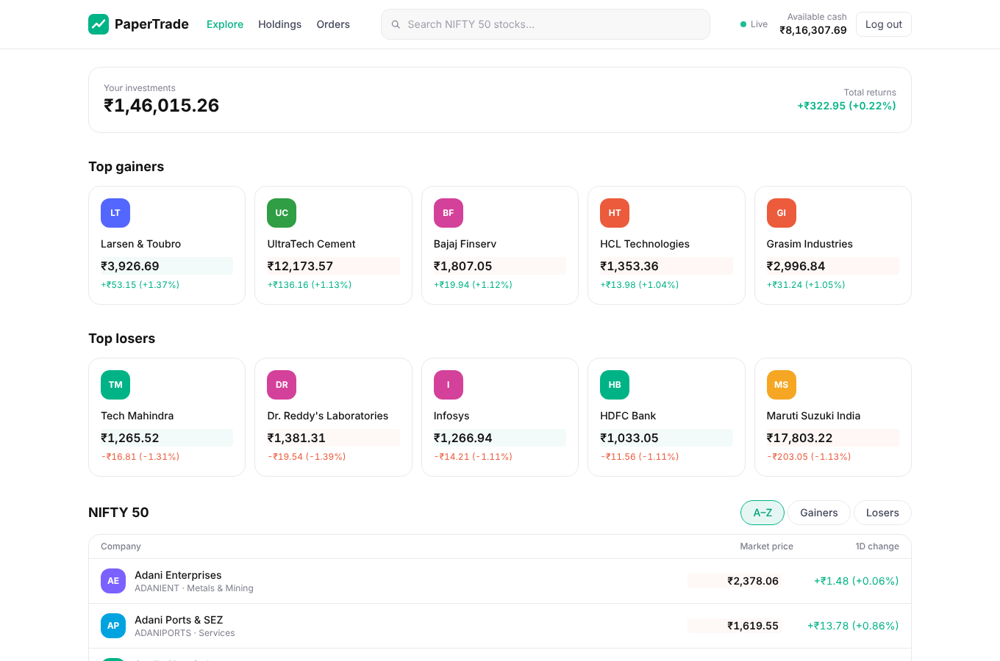
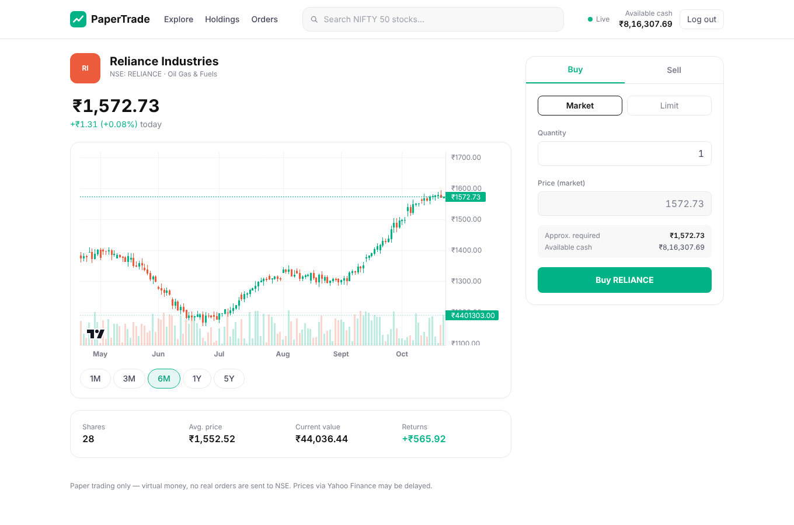
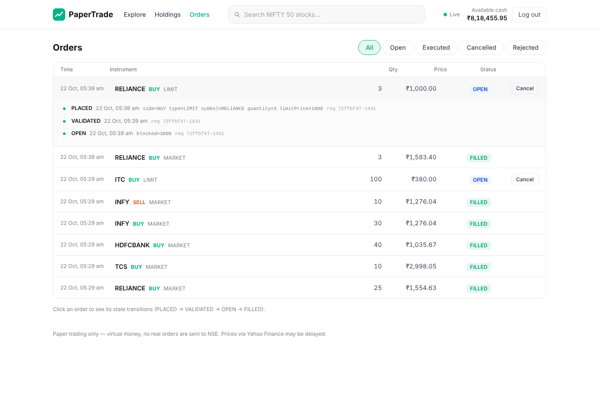
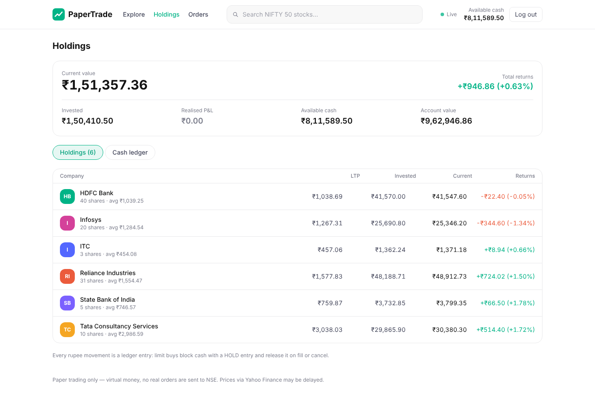
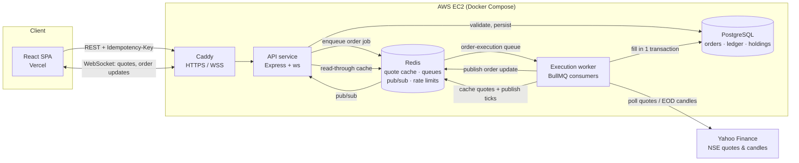
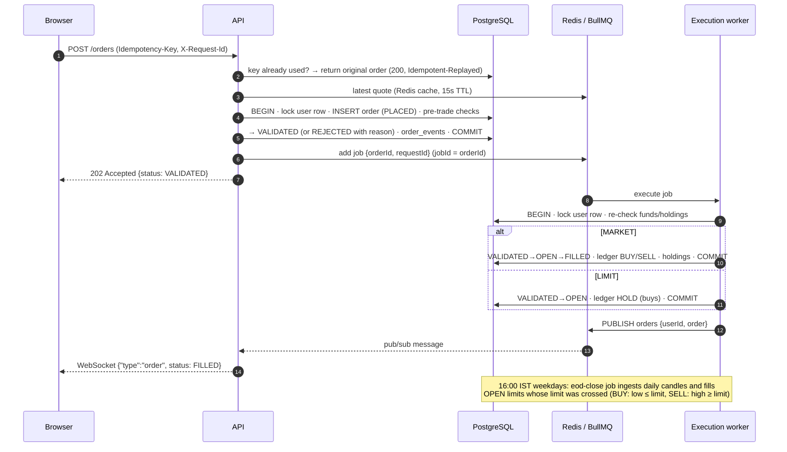
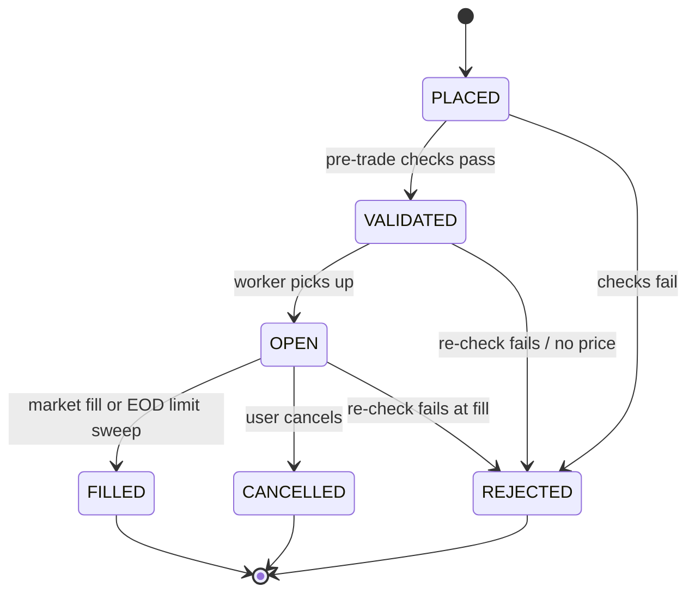
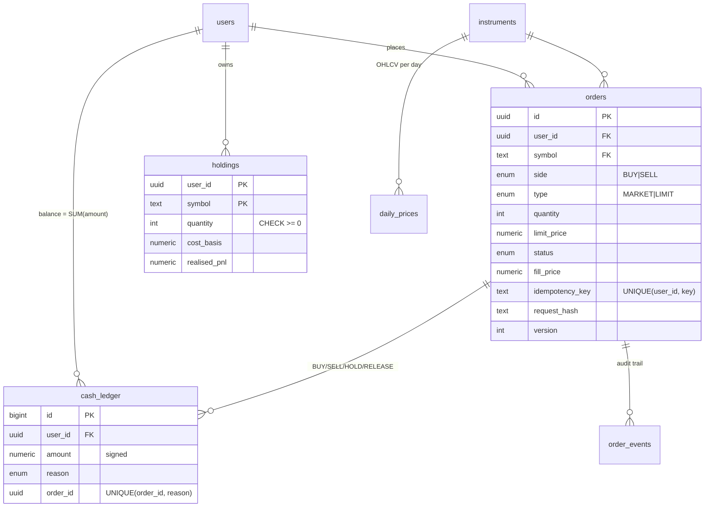

# NSE Paper Trading

[](https://github.com/shashankappu21/nse-paper-trading/actions/workflows/ci.yml)

A **broker-style paper trading platform for NSE stocks**. Users get ₹10,00,000 of virtual cash, place
market and limit orders on NIFTY 50 stocks at real market prices, and track their holdings and P&L, with
live prices pushed over WebSockets.

It is modelled on a **broker** (like Zerodha), **not an exchange**: there is no order book and no matching
engine. Orders fill against the latest market price, the way a broker's paper-trading or virtual-contract
mode would. [Why that matters ↓](#why-there-is-no-order-book)

**Stack:** Node.js 22 · TypeScript · Express · PostgreSQL 16 · Redis 7 · BullMQ · zod · Jest · React 19 ·
Vite · Tailwind 4 · TradingView lightweight-charts · Docker · GitHub Actions · k6 · Caddy · AWS EC2 · Vercel

| Explore (live prices) | Stock page (candles + order ticket) |
|---|---|
|  |  |
| **Orders (event timeline, cancel)** | **Holdings (live P&L)** |
|  |  |

### At a glance

| | |
|---|---|
| HTTP endpoints | **16** REST operations + **1** WebSocket (`/ws`) — documented at `/docs` (Swagger) |
| Database tables | **7** (`users`, `instruments`, `daily_prices`, `orders`, `order_events`, `holdings`, `cash_ledger`) |
| Tests | **139** Jest tests (62 unit, 77 integration against real Postgres/Redis/BullMQ) · 92% statement coverage · green on GitHub Actions |
| Market data | Verified against **live Yahoo Finance** for all 50 NIFTY 50 stocks: quotes + 2 years of daily candles (24,700 bars) |
| Load test (k6, 50 VUs) | **353 req/s**, order placement **p95 105 ms**, **0 errors** in 31,240 requests |
| Execution latency | API accept → worker fill: **p50 23 ms, p95 40 ms** (21,756 market orders) |
| Correctness under load | **0** ledger/holding/event-trail violations across 27,924 orders |

📖 **Deeper reading:** [Build journal — decisions and challenges](docs/JOURNEY.md) ·
[Design decisions (ADRs)](docs/DECISIONS.md) · [Load testing report](docs/LOAD_TESTING.md) ·
[Deployment guide (EC2 + Caddy + Vercel)](docs/DEPLOYMENT.md) · [EC2 via SSM + CloudFormation](docs/AWS_SETUP.md) ·
[Interview prep](docs/INTERVIEW_PREP.md)

---

## Architecture



**Code layout (npm workspaces monorepo):**

```
apps/
  api/        Express HTTP API + WebSocket server (routes → services; no business logic in routes)
  worker/     BullMQ consumers: order execution, EOD close, quote polling, reconciler
  web/        React + Vite + Tailwind frontend
packages/
  shared/     zod schemas, enums and DTO types shared by api, worker and web
  core/       domain logic, services, repositories (all SQL), market data, queue definitions, migrations
infra/        k6 load test + results, Caddyfile
docs/         journey, decisions, load testing, deployment, interview prep, screenshots
```

Layering inside the backend is strict: **routes → services → repositories**.

- *Routes* only parse/validate (zod) and map to HTTP.
- *Services* hold business rules and transactions, never SQL.
- *Repositories* are the only place with SQL; every function takes a `Db` (pool or transaction client)
  so services compose them inside one transaction.
- *Domain* modules (`orderStateMachine`, `portfolioMath`, `preTradeChecks`) are pure functions with no I/O,
  which is why they are trivial to unit test.

`packages/core` exists so the **API and the worker share one implementation** of execution, ledger and
portfolio logic — two deployables, one source of truth.

## Order flow



**Order state machine** (enforced in code *and* by a compare-and-set `UPDATE … WHERE status = $expected`):



Every transition writes an `order_events` row carrying the **request id**, so one id traces an order from
the HTTP request, through the queue, into the worker and the database.

## Data model



Indexes on the hot paths: `orders (user_id, status, created_at DESC)` for the order book and sell
reservations; a **partial** index `orders (symbol) WHERE status='OPEN' AND type='LIMIT'` for the EOD sweep;
`daily_prices` primary key `(symbol, date)` for candle range scans; `cash_ledger (user_id, id)` for balances.

## Getting started

### Option A — everything in Docker (one command)

```bash
cp .env.example .env                       # set JWT_SECRET (openssl rand -hex 32)
# no internet / Yahoo blocked? set MARKET_DATA_PROVIDER=fake for a deterministic offline market
docker compose up --build
```

| URL | What |
|---|---|
| http://localhost:8080 | Web app (nginx serving the production build, proxying `/api` and `/ws`) |
| http://localhost:4000/docs | Swagger UI |
| http://localhost:4000/ready | Readiness (Postgres + Redis) |

Compose starts Postgres and Redis, waits for their health checks, runs a one-shot **migrate + seed**
container (NIFTY 50, ~2 years of daily candles, demo account), and only then starts the API, worker and web.

**Demo account:** `demo@nsepaper.dev` / `Demo@12345` — or click *Try the demo account* on the login page.

### Option B — local development

Requires Node 22, PostgreSQL 16 and Redis 7 (e.g. `docker compose up -d postgres redis` and expose ports, or local installs).

```bash
npm install
cp .env.example .env            # DATABASE_URL / REDIS_URL point at localhost
createdb trading && createdb trading_test
npm run seed                    # migrations + instruments + candles + demo account (idempotent)
npm run dev:api                 # http://localhost:4000
npm run dev:worker              # execution worker + schedulers
npm run dev:web                 # http://localhost:5173 (proxies /api and /ws to :4000)
```

Set `EXECUTION_MODE=sync` to run without the worker (the API executes orders in-process — handy for
debugging; tests use this mode for the service-level suites).

### Useful scripts

| Command | |
|---|---|
| `npm test` | All 139 tests (needs Postgres + Redis; uses `trading_test` and Redis DB 15) |
| `npm run test:unit` | Pure domain tests only, no infrastructure |
| `npm run lint` · `npm run typecheck` | ESLint · `tsc -b` for every package + web |
| `npm run migrate` · `npm run seed` | Apply migrations · seed (both idempotent) |
| `npm run eod -w apps/worker [-- 2026-10-21]` | Enqueue the end-of-day job now |

## API

Base path `/api/v1`. Full schema at **`/docs`** (generated from the same zod schemas the routes validate with).

| Method | Path | Auth | Description |
|---|---|---|---|
| GET | `/health` | – | Liveness |
| GET | `/ready` | – | Readiness: Postgres + Redis |
| POST | `/auth/register` | – | Create account, credited ₹10,00,000 via a `DEPOSIT` ledger entry |
| POST | `/auth/login` | – | Returns a JWT (HS256) |
| GET | `/auth/me` | JWT | Profile + available cash |
| GET | `/instruments?q=` | – | Search NIFTY 50 with cached quotes |
| GET | `/instruments/top` | – | Top gainers / losers |
| GET | `/instruments/:symbol` | – | Instrument + latest quote |
| GET | `/instruments/:symbol/candles?range=1M\|3M\|6M\|1Y\|5Y` | – | Daily OHLCV |
| GET | `/quotes?symbols=A,B` | – | Batch quotes from Redis |
| POST | `/orders` | JWT | Place order — **requires `Idempotency-Key`**; 202 (queued) / 201 / 200 (replay) |
| GET | `/orders?status=` | JWT | List orders |
| GET | `/orders/:id` | JWT | Order + full event history |
| POST | `/orders/:id/cancel` | JWT | Cancel an OPEN order (releases blocked cash) |
| GET | `/portfolio` | JWT | Holdings, avg price, current value, realised/unrealised P&L |
| GET | `/portfolio/ledger` | JWT | Cash ledger |
| WS | `/ws?token=` | optional | `{"type":"subscribe","symbols":[…]}` → `quote` ticks; with a token, also your `order` updates |

**Errors** always look like this, with the same `requestId` as the `X-Request-Id` response header:

```json
{ "error": { "code": "VALIDATION_ERROR", "message": "Request validation failed",
             "details": [{ "in": "body", "path": "limitPrice", "message": "limitPrice is required for LIMIT orders" }],
             "requestId": "3f0c…" } }
```

Business rejections (insufficient funds/holdings, no price) are **not** HTTP errors: the order is recorded
as `REJECTED` with a `rejectReason`, exactly like a broker's order book shows rejected orders.

Example:

```bash
TOKEN=$(curl -s localhost:4000/api/v1/auth/login -H 'content-type: application/json' \
  -d '{"email":"demo@nsepaper.dev","password":"Demo@12345"}' | jq -r .token)

curl -i localhost:4000/api/v1/orders -H "authorization: Bearer $TOKEN" -H 'content-type: application/json' \
  -H "Idempotency-Key: $(uuidgen)" -d '{"symbol":"RELIANCE","side":"BUY","type":"MARKET","quantity":5}'
# HTTP/1.1 202 Accepted   {"status":"VALIDATED", …}   → worker fills it ~20-40 ms later
```

## Testing

Written **test-first** for the order logic: the specs were committed red
([`ffdcb71`](docs/JOURNEY.md#stage-1--the-synchronous-core-tdd)) before any implementation existed.

| Suite | Tests | What it proves |
|---|---|---|
| `core-unit` · state machine | 38 | All 36 from→to pairs: 7 allowed, 29 rejected with `INVALID_STATE_TRANSITION`; terminal states |
| `core-unit` · P&L math | 8 | Average-cost method, realised/unrealised P&L, **no paise lost across partial sells** |
| `core-unit` · pre-trade checks | 5 | Buying power to the paisa, reserved sell quantity |
| `core-unit` · Yahoo provider | 11 | `SYMBOL.NS` mapping (incl. `M&M`), IST date keying, paise rounding, missing-price handling — `yahoo-finance2` mocked with shapes captured from live responses |
| `core-integration` · order flow | 28 | Market/limit fills, insufficient funds/holdings, cash blocking, cancellation, duplicate & **concurrent** idempotency keys, concurrent overspend, retries, P&L, exit-only for stocks that left the index |
| `core-integration` · auth, market data, ingest | 15 | bcrypt + JWT, Redis TTL, **single-flight** cache stampede protection, stale fallback, concurrent ingest count, **retry after a transient provider error**, index rejig |
| `api` | 28 | HTTP contract, error envelope, request-id echo, rate limits, OpenAPI coverage, WebSocket fan-out and auth |
| `worker` | 6 | Real BullMQ: async fill, request-id across the hop, job dedupe, **reconciler recovers a lost enqueue**, EOD job |
| **Total** | **139** | 92.2% statements · 93.9% lines |

Integration tests run against **real PostgreSQL and Redis** (CI uses service containers). The correctness of
this system lives in constraints, row locks and transactions — mocking the database would test nothing.

```
Test Suites: 12 passed, 12 total
Tests:       139 passed, 139 total
```

## Load test results (k6)

Script: [`infra/k6/place-orders.js`](infra/k6/place-orders.js). Mix: 70% market buys, 20% limit buys,
10% **replays of an earlier Idempotency-Key** (asserted to return the *same* order id). Run against the full
Docker Compose stack on a single 4-vCPU machine (k6 on the same host). Raw output in
[`infra/k6/results/`](infra/k6/results).

| Scenario | Throughput | Order placement latency | Errors |
|---|---|---|---|
| **Baseline** — 50 VUs, 50 ms think time, 1 API | **353 req/s** | p50 73 ms · **p95 105 ms** · p99 119 ms | **0 / 31,240** |
| Stress — 200 VUs, no think time, 1 API | 325 req/s | p95 568 ms · p99 615 ms | 0 / 25,668 |
| Stress — 200 VUs, **3 API replicas** behind nginx | 397 req/s | p95 895 ms · p99 1.02 s | 0 / 31,587 |

- **All thresholds passed** (p95 < 250 ms, error rate < 1%, 3,103/3,103 idempotent replays matched).
- **Async execution latency** (API commit → worker fill, from DB timestamps): **p50 23 ms, p95 40 ms, p99 57 ms**.
- **Post-run invariants** (SQL): every filled buy has exactly one ledger debit of `qty × fill_price`; no duplicate
  `(order, reason)` ledger rows; no negative balances; every OPEN limit buy holds exactly `qty × limit`;
  holdings equal the sum of filled quantities; every order has a complete event trail — **0 violations**.
- **Bottleneck:** with one API replica the Node event loop sits at ~95% of one core while Postgres has headroom.
  With three replicas each API drops to ~50% CPU and **Postgres becomes the bottleneck** (~150% CPU) on the
  shared 4-vCPU host. See the [load testing report](docs/LOAD_TESTING.md) for analysis and next optimizations.

## Decisions and trade-offs

The full set (with alternatives considered) is in [docs/DECISIONS.md](docs/DECISIONS.md). The headline ones:

### Why there is no order book

A paper-trading platform does not own a market — **NSE does**. A real broker (Zerodha, Groww) does not match
its customers' orders against each other; it routes them to the exchange, where they meet the *whole market's*
liquidity. Building a matching engine here would be modelling the wrong system:

- **Users would trade against each other, not the market.** With a few hundred users, a buy order would sit
  unfilled until another user happened to sell — prices would be fiction, not NSE prices.
- **It's the wrong scaling problem for this domain.** A matching engine is a single-writer, in-memory,
  latency-critical component (price-time priority, partial fills). A broker's backend problems are different:
  correctness of money movement, idempotency, risk checks, audit trails, and integrating with a market data feed.
  Those are what this project demonstrates.
- **The fill model is honest about its limits.** Market orders fill at the latest cached quote (no slippage, no
  partial fills, no market depth). Limit orders are evaluated **once a day after close** against that day's
  candle: a BUY fills if `low ≤ limit`, a SELL if `high ≥ limit`, at the limit price, and only if the order was
  placed before 15:30 IST that day. That is conservative (a real fill could be better on a gap) and needs only
  daily data, which is free and reliable.

What it costs: no intraday limit fills, no partial fills, no slippage model. Each would be an extension of
the `ExecutionService`, not a redesign.

### Other key decisions

| Decision | Why | Trade-off |
|---|---|---|
| **Per-user row lock** (`SELECT … FOR UPDATE` on `users`) around every money movement | Serialises one user's fills/cancels so two concurrent orders can't both spend the same cash. Lock order is always user → order, so no deadlocks. | Orders of the *same user* execute one at a time — fine for a retail broker. |
| **Re-check funds at fill time** in the worker | The API's check is a fast pre-trade check; the worker's check, under the lock, is authoritative. | A user can see VALIDATED → REJECTED. That's what brokers do. |
| **Idempotency in Postgres**, not Redis | `UNIQUE(user_id, idempotency_key)` is written in the same transaction as the order — atomic and durable. A request hash rejects key reuse with a different body (422). | One extra indexed lookup per request. |
| **Ledger as the source of truth**; balance = `SUM(amount)` | Every rupee has a reason and an order id. Limit buys `HOLD` cash; fill/cancel `RELEASE` it. `UNIQUE(order_id, reason)` makes double-debits impossible. | `SUM` grows with history — next step is a balance snapshot column maintained in the same transaction. |
| **Integer paise + cost basis** instead of float rupees + avg price | No floating-point drift; partial sells remove a proportional share of cost so the last share consumes exactly what's left. | Conversions at the edges (DTOs are rupees). |
| **BullMQ with `jobId = orderId`** + idempotent executor | At-least-once delivery is safe: re-running a processed order is a no-op. Dedupes double dispatch. | Needs Redis persistence (AOF on). |
| **Reconciler** instead of a transactional outbox | If the API dies between COMMIT and enqueue, a 60 s job re-dispatches stale VALIDATED orders; idempotent replays also re-dispatch. | Up to ~90 s delay in that crash case. An outbox table would make it immediate — documented as the upgrade. |
| **Schedules as BullMQ job schedulers** (not node-cron) | Stored in Redis: N worker replicas never run the EOD job twice. | Depends on Redis for scheduling. |
| **Strict quotes for fills, stale-OK for display** | Never fill at an unknown price (`PRICE_UNAVAILABLE`), but keep the UI useful if Yahoo hiccups. Single-flight prevents cache stampedes. | Market orders fail fast during provider outages. |
| **Redis pub/sub → WebSocket** | Any API replica can serve any socket; the worker doesn't know who's connected. | Pub/sub is fire-and-forget; clients re-fetch on reconnect. |
| **Real Postgres in tests** | The guarantees are in constraints and locks. | Tests need infrastructure (CI service containers). |

## Deployment

Single **AWS EC2** instance running the Compose stack with **Caddy** for automatic HTTPS, frontend on **Vercel**.
Step-by-step guide: [docs/DEPLOYMENT.md](docs/DEPLOYMENT.md).

```bash
docker compose -f docker-compose.yml -f docker-compose.prod.yml up -d --build
```

- Multi-stage Dockerfiles (`build → prod-deps → runtime`), ~70 MB compressed, running as the unprivileged `node` user
- Health checks gate start-up: postgres/redis healthy → migrate+seed completes → api/worker start → caddy
- All config via environment variables ([`.env.example`](.env.example)); secrets never committed or baked into images

## CI

[`.github/workflows/ci.yml`](.github/workflows/ci.yml) on every push: `npm ci` → ESLint → `tsc -b` (all
packages + web) → Jest against Postgres/Redis service containers (with coverage) → web build → Docker builds
for api, worker and web (buildx with GitHub Actions cache).

## Project history

Built in four stages, each working end-to-end and committed before the next. The full story — every decision
and every bug hit along the way — is in **[docs/JOURNEY.md](docs/JOURNEY.md)**.

1. Schema, migrations, auth, market data cache, synchronous order flow — **tests first**
2. Execution moved into a BullMQ worker; scheduled EOD limit-order job; reconciler
3. React frontend with live prices and order updates over WebSockets
4. OpenAPI, rate limiting, CI, Docker, Compose, k6, deployment

---

*Paper trading only. No real orders are sent anywhere. Market data from Yahoo Finance is unofficial and may be delayed.*
